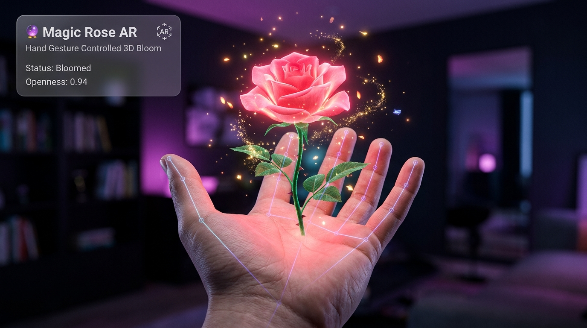

<div align="center">

# 🌹 Magic Rose AR

### An Interactive Augmented Reality 3D Flower Controlled by Hand Gestures

[](https://vitejs.dev/)
[](https://threejs.org/)
[](https://developers.google.com/mediapipe)
[](https://greensock.com/gsap/)
[](LICENSE)

<br/>



<br/>
<br/>

**Magic Rose** is an in-browser augmented reality experience that lets you sprout, grow, and bloom a radiant 3D rose directly in the palm of your hand. Powered by Google MediaPipe's on-device computer vision and Three.js WebGL rendering, it bridges machine learning with interactive generative 3D art in real time.

[✨ Live Demo](https://harshit-tomar-dev.github.io/magic-rose/) • [Report Bug](https://github.com/harshit-tomar-dev/magic-rose/issues) • [Request Feature](https://github.com/harshit-tomar-dev/magic-rose/issues)

</div>

---

## 📖 Overview

Magic Rose transforms your standard webcam into an interactive AR portal without requiring headsets or dedicated hardware. Using edge AI running directly on your GPU, the system tracks 21 distinct 3D hand landmarks at 60 FPS, turning natural physical gestures into lifecycle triggers for a procedural botanical simulation:

1. **Pinch fingers** in front of your camera to plant a glowing golden seed in your palm.
2. **Open your hand** to watch an organic stem shoot upwards and sprout lush green leaves.
3. **Hold your hand open** to ignite an 80-particle shimmer burst as three concentric layers of velvety rose petals unfurl into full bloom.
4. **Curl and relax your fingers** to dynamically control petal opening angles and core illumination in real time.
5. **Move your hand nearer or further** from the camera to dynamically scale the flower in 3D perspective.

---

## 🛠️ Tech Stack Used

| Technology | Role & Purpose |
| :--- | :--- |
| **[Three.js](https://threejs.org/)** (v0.185) | High-performance WebGL 3D rendering engine. Generates procedural Bezier petal geometries, leaf extrusions, PBR materials (`MeshPhysicalMaterial`), ACESFilmic tone-mapping, dynamic point lights, and `THREE.Points` particle systems. |
| **[@mediapipe/tasks-vision](https://developers.google.com/mediapipe)** (v0.10) | Client-side neural hand tracking using Google's `HandLandmarker` model with WebAssembly and GPU acceleration. Detects 21 3D hand landmarks in real time with single-digit millisecond latency. |
| **[GSAP](https://greensock.com/gsap/)** (v3.15) | GreenSock Animation Platform. Orchestrates springy multi-layered petal unfurling tweens (`back.out`), emission ramp-ups, particle physics lifecycles, and fade transitions. |
| **[Vite](https://vitejs.dev/)** (v8.x) | Modern frontend development and bundling tooling providing instant HMR and optimized production build chunking. |
| **Vanilla JavaScript (ES Modules)** | Clean, decoupled, modular architecture with zero heavy frontend framework overhead, maximizing frame rates and responsiveness. |
| **CSS3 Glassmorphism HUD** | Futuristic AR overlay featuring backdrop blur filters, glowing status pills, keyboard badge hints, and responsive mobile-ready controls. |

---

## 🎮 Gesture Controls & User Guide

| Gesture | Visual | Action in Experience |
| :--- | :---: | :--- |
| **Pinch** | 🤏 | **Spawn Seed**: Bring thumb and index fingertips close together (< 0.06 normalized distance) to plant a luminous seed with a golden particle burst. |
| **Open Hand** | 🌿 | **Grow Stem & Leaves**: Slowly extend your fingers. The stem height and leaf emergence dynamically map to your finger extension levels. |
| **Hold Open** | 🌸 | **Trigger Bloom**: Keep your palm wide open for 300ms to trigger the cinematic 3-layer bloom sequence with an ambient pink point light burst. |
| **Finger Flex** | ✨ | **Dynamic Petal Articulation**: Once bloomed, curl and open your fingers to breathe life into the flower — petals open and close following your hand. |
| **Depth Distance** | ↕️ | **Perspective Scaling**: Bring your hand closer to or further from the camera to smoothly scale the flower and particle effects in 3D space. |

### ⌨️ Keyboard Shortcuts

- <kbd>R</kbd> — **Force Reset**: Instantly resets the flower lifecycle back to the initial state.
- <kbd>D</kbd> — **Toggle Landmarks**: Shows/hides the 21-point MediaPipe glowing wireframe tracking skeleton.
- <kbd>H</kbd> — **Toggle Guide**: Toggles the on-screen gesture cheat-sheet card.

---

## 🧠 Engineering & Technical Highlights

### 1. Perspective-Invariant Gesture Detection
Traditional computer vision apps measure raw 2D pixel distance between fingertips and wrist to estimate hand openness. However, that metric produces severe false positives when a hand tilts downward or moves forward toward the lens due to perspective foreshortening. 

Magic Rose solves this by computing the 3D interior bend angle at each finger's **Proximal Interphalangeal (PIP)** joint across index, middle, ring, and pinky:
```
straight finger (~180°) ➔ openness = 1.0
curled finger   (≤ 70°) ➔ openness = 0.0
```
This angle remains invariant under rotation and depth, providing rock-solid gesture recognition.

### 2. Raycast Unprojection & AR Compositing
To make the 3D flower look like it is physically attached to your palm, screen-space landmark coordinates must align with the camera feed:
- Accommodates CSS `object-fit: contain` and horizontal selfie mirroring (`scaleX(-1)`).
- Maps normalized video coordinates to screen pixels and NDC (`[-1, 1]`).
- Casts a Three.js camera ray through the screen coordinate onto an anchor depth plane at $Z = 0$.

### 3. Decoupled 60 FPS Exponential Damping
Rather than updating 3D mesh transforms directly on MediaPipe's detection callbacks (which may tick at 30 Hz), transforms are smoothed independently on every `requestAnimationFrame` tick using exponential decay:
$$\text{position} \leftarrow \text{position} + (\text{target} - \text{position}) \times (1 - e^{-\lambda \Delta t})$$
This eliminates micro-stutter and creates a buttery-smooth, fluid AR illusion.

---

## 🚀 Quick Start

### Prerequisites
- [Node.js](https://nodejs.org/) (version 18+ recommended)
- A working webcam connected to your device
- A modern browser with WebGL and WebAssembly support (Chrome, Edge, Brave, Firefox, Safari)

### Installation

1. **Clone the repository:**
   ```bash
   git clone https://github.com/harshit-tomar-dev/magic-rose.git
   cd magic-rose
   ```

2. **Install dependencies:**
   ```bash
   npm install
   ```

3. **Launch the local development server:**
   ```bash
   npm run dev
   ```
   Open your browser to the URL displayed (usually `http://localhost:5173`).

4. **Build for production:**
   ```bash
   npm run build
   ```
   The compiled assets will be in the `dist/` directory, ready to deploy to GitHub Pages, Vercel, or Netlify.

---

## 📁 Project Architecture

```
magic-rose/
├── assets/
│   └── demo.jpg                    # High-definition showcase demo screenshot
├── public/
│   ├── favicon.svg                 # Project favicon
│   └── icons.svg                   # Vector icon symbols
├── src/
│   ├── core/
│   │   └── scene.js                # Three.js scene, camera, lights, ACES tone-mapping & render loop
│   ├── effects/
│   │   └── particles.js            # THREE.Points particle bursts & additive shimmer effects
│   ├── flower/
│   │   ├── flowerController.js     # Lifecycle state machine (IDLE -> SEED -> GROWING -> BLOOMED)
│   │   ├── leaves.js               # Procedural extruded leaf geometry & growth synchronizer
│   │   ├── rose.js                 # 3-tier petal geometries, bloom animation & idle sway
│   │   ├── seed.js                 # Glowing golden seed mesh & glow pulse
│   │   └── stem.js                 # Cylinder stem geometry with bottom-pivot scale growth
│   ├── styles/
│   │   └── main.css                # Glassmorphism AR HUD styling, keybindings & animations
│   ├── utils/
│   │   ├── coordMapper.js          # Raycasting screen pixels to 3D Three.js world coordinates
│   │   └── videoCoverMapper.js     # Object-fit & mirror coordinate normalization
│   ├── vision/
│   │   ├── debugOverlay.js         # Canvas 2D landmark tracking skeleton renderer
│   │   ├── gestureDetector.js      # Finger angle solver (pinch, openness, depth, swipe)
│   │   ├── handTracker.js          # MediaPipe HandLandmarker initialization & inference
│   │   └── webcam.js               # WebRTC getUserMedia video capture handler
│   └── main.js                     # Application entry point & interactive UI controller
├── index.html                      # HTML5 AR view shell with metadata & glassmorphism HUD
├── LICENSE                         # MIT License
├── package.json                    # Project metadata, scripts, and dependencies
└── README.md                       # Comprehensive documentation & showcase
```

---

## ⚙️ Configuration & URL Parameters

| Parameter | Default | Description |
| :--- | :---: | :--- |
| `?debug=1` | `false` | Automatically enables the hand landmark wireframe mesh overlay upon launch. |
| `?debug=0` | `true` | Suppresses the landmark debug wireframe on startup. |

You can also press <kbd>D</kbd> or click the **Wireframe** button on the HUD at any time during gameplay to toggle this interactively.

---

## 🤝 Contributing

Contributions, issues, and feature requests are always welcome!
Feel free to check the [issues page](https://github.com/harshit-tomar-dev/magic-rose/issues).

1. Fork the Project
2. Create your Feature Branch (`git checkout -b feature/AmazingFeature`)
3. Commit your Changes (`git commit -m 'Add some AmazingFeature'`)
4. Push to the Branch (`git push origin feature/AmazingFeature`)
5. Open a Pull Request

---

## 📄 License

Distributed under the **MIT License**. See [`LICENSE`](LICENSE) for more information.

---

<div align="center">
  Crafted with ❤️ by <a href="https://github.com/harshit-tomar-dev">Harshit Tomar</a>
  <br/>
  <i>Star ⭐ this repository if you loved the Magic Rose!</i>
</div>
